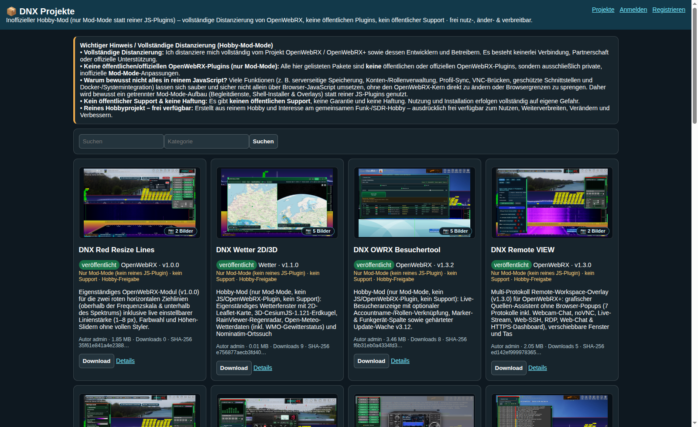
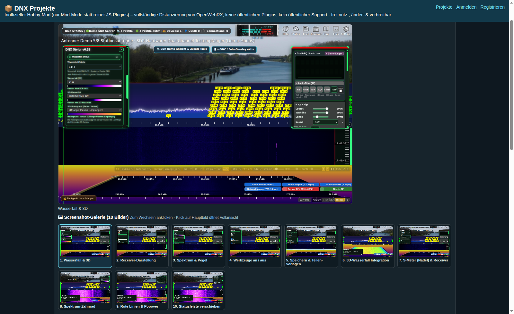

# DNX Project Manager Standalone (`v1.1.0`)

<!-- DNX-DISCLAIMER-START -->
> **Wichtiger Hinweis / Vollständige Distanzierung (Hobby-Mod-Mode)**
>
> - **Vollständige Distanzierung:** Ich distanziere mich in jeder Hinsicht vollständig vom Projekt **OpenWebRX / OpenWebRX+** sowie dessen Entwicklern und Betreibern. Es besteht keinerlei Verbindung, Zusammenarbeit, Prüfung, Befürwortung oder Partnerschaft.
> - **Keine öffentlichen/offiziellen OpenWebRX-Plugins (nur Mod-Mode):** Bei diesem Projekt handelt es sich ausdrücklich **nicht** um ein öffentliches oder offizielles Plugin von OpenWebRX, sondern ausschließlich um einen privaten, inoffiziellen **Mod-Mode** (Eigenmodifikation).
> - **Warum bewusst kein reines Browser-JavaScript (Mod-Mode-Architektur):** Viele Funktionen (z. B. serverseitige Speicherung, Konten-/Rollenverwaltung, Profil-Synchronisation, VNC-/websockify-Brücken, geschützte Schnittstellen, Docker-/Systemintegration und stabile UI-Anpassungen) lassen sich sauber und sicher nicht allein über simples Client-JavaScript umsetzen, ohne den OpenWebRX-Kern umzubauen oder Browsergrenzen zu umgehen. Deshalb setzt dieses Projekt bewusst auf getrennte Begleitmodule, Shell-Installer und Dienste im **Mod-Mode** statt alles künstlich in reines JavaScript zu pressen.
> - **Kein öffentlicher Support & keine Haftung:** Es gibt **keinen öffentlichen Support**, keine Garantie und keine Haftung. Nutzung, Installation und Anpassung erfolgen vollständig auf eigene Gefahr (immer vorher Backups anlegen und zunächst im eigenen Testsystem prüfen).
> - **Reines Hobbyprojekt – frei nutzbar, änderbar & verbreitbar:** Dieses Projekt entsteht ausschließlich aus reinem Hobby und Interesse am gemeinsamen Funk-/SDR-Hobby. Es steht ausdrücklich frei zur Verfügung und darf frei genutzt, weiterverbreitet, verändert und verbessert werden.
<!-- DNX-DISCLAIMER-END -->

> **Important Notice / Full Disassociation (Hobby Mod-Mode Only)**
>
> - **Full Disassociation:** I completely disassociate myself from **OpenWebRX / OpenWebRX+** and its developers/maintainers. There is no affiliation, endorsement, review, or partnership of any kind.
> - **No Official/Public OpenWebRX Plugins (Mod-Mode Only):** These files are **not** official or public OpenWebRX plugins, but purely unofficial hobby modifications (*mod-mode*).
> - **Why Not Everything in Pure Browser JavaScript:** Many features (server-side persistence, account/role management, profile syncing, VNC/websockify bridges, protected endpoints, and Docker/host integration) cannot be implemented cleanly or reliably in client-side JavaScript alone without modifying the OpenWebRX core or hitting browser/security limits. That is why this project intentionally uses separate companion scripts, services, and *mod-mode* hooks rather than forcing everything into pure JS.
> - **No Public Support & No Warranty:** There is **no public support**, no warranty, and no liability. Use entirely at your own risk (always create backups and verify on a test system first).
> - **Pure Hobby Project — Free to Use, Modify & Redistribute:** Created solely out of personal hobby interest in the radio/SDR hobby; freely available to use, share, modify, and improve.

<!-- DNX-PREVIEW-START -->
## Live-Vorschau & Galerie / Live Preview (`DNX Project Manager Standalone`)



| Ansicht / View | Beschreibung / Description | Screenshot |
|---|---|---|
| **Projekt-Übersicht mit Galerie-Badges** | Startseite mit `📷 N Bilder`-Zähler auf den Projektkarten, Volltextsuche, Kategoriefilter und SHA-256-Prüfsummen |  |
| **Detailansicht & Multi-Bild-Streifen** | Projekt-Detailseite mit großem Vorschaubild, Bildunterschrift und klickbarem Thumbnail-Streifen darunter |  |
| **Vollbild-Lightbox (`←` / `→` / `Esc`)** | Interaktive Lightbox-Vollansicht zum Blättern durch alle Screenshots eines Projekts |  |
| **OpenWebRX-Schnellbutton (`📦 Projekte / Downloads`)** | Optionaler, frei verschiebbarer Schnellöffner-Button direkt in OpenWebRX+ (`install-button.sh`) |  |
<!-- DNX-PREVIEW-END -->

Eigenständiger Projekt- und Download-Manager (`v1.1.0`) auf Basis von Python, Flask, Waitress und SQLite – ohne Eingriff in OpenWebRX-Benutzer oder -Sitzungen.

Standalone Flask/Waitress/SQLite project repository & download manager (`v1.1.0`) with multi-image project galleries, interactive lightbox viewer, ClamAV upload quarantine, and an optional draggable OpenWebRX quick-launch button.

## Neu in v1.1.0 / What's New

- **Multi-Bild-Galerien (`MAX_PREV_COUNT = 12`):** Upload mehrerer Vorschaubilder pro Projekt (`previews_multi`) beim Erstellen und Bearbeiten, automatische `📷 N Bilder`-Badges in der Kartenübersicht, Thumbnail-Streifen (`gal-strip`) sowie Vollbild-Lightbox (`←`, `→`, `Esc`) in der Detailansicht.
- **OpenWebRX-Schnellbutton (`install-button.sh` + `files/dnx_project_manager_button.js`):** Optionales Receiver-Script, das einen frei verschiebbaren Button `📦 Projekte / Downloads` (`dnx.pm.btn.pos.v1`, Doppelklick = Reset) in OpenWebRX+ einblendet.
- **Sicherheits- & Konten-System:** `scrypt`-Passwort-Hashing, CSRF-Schutz, Admin-Freigabe neuer Konten, `trusted`-Direktfreigabe, ClamAV-Quarantäne-Workflow sowie Audit-Log.

## Dateien im Paket / Package Contents

| Datei | Zweck / Purpose |
|---|---|
| `app.py` | Vollständiger Flask-/SQLite-Server inkl. Multi-Bild-Galerie & Admin-Panel (`v1.1.0`) |
| `install.sh` | Installer für `systemd`-Dienst (`dnx-project-manager.service`, Port `8094`) |
| `install-button.sh` | Optionaler OpenWebRX-Button-Installer (`TYP=auto/normal`, `CONTAINER=...`, `PM_URL=...`) |
| `files/dnx_project_manager_button.js` | Frei verschiebbarer `📦 Projekte / Downloads`-Button für OpenWebRX+ |
| `docs/` | 4 Funktionsscreenshots (`1600×980`) |

## Installation & Bedienung / Usage

```bash
chmod +x install.sh install-button.sh
# 1) Projekt-Manager Server (Port 8094) installieren + ersten Admin anlegen:
sudo ./install.sh install
# Oder vorhandene Installation sauber aktualisieren (Daten bleiben erhalten):
sudo ./install.sh update
./install.sh status

# 2) Optional: Schnellöffner-Button in OpenWebRX+ einbauen:
sudo PM_URL="http://DEIN-SERVER:8094/" ./install-button.sh install
```

---

## Verbindungen im DNX-Ökosystem


* **Verbindung zu `DNX-Receiver-Account-Control` (`:8095/api/me`):** Die Rechte **`projects_view`**, **`project_upload`**, **`project_manage`** und **`downloads`** steuern Lese-, Upload- und Verwaltungszugriff konsistent zur zentralen Rollenverwaltung.
* **Verbindung zum Receiver-Frontend:** Über `files/dnx_project_manager_button.js` fügt sich der frei verschiebbare Schnellbutton (`📦 Projekte / Downloads`) nahtlos in die DNX-Werkzeugleiste ein.
